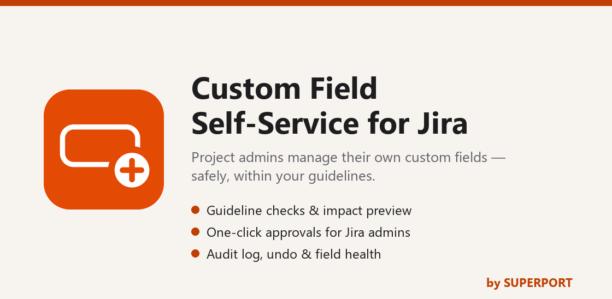
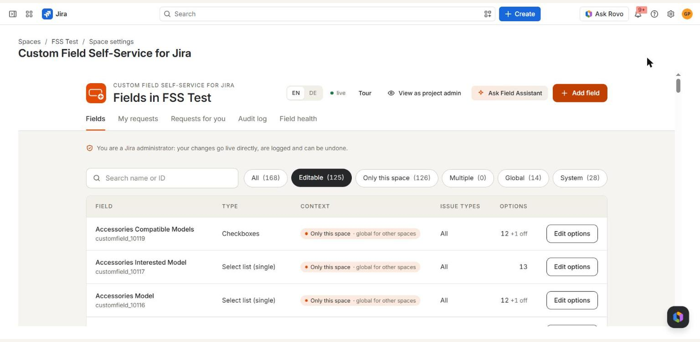
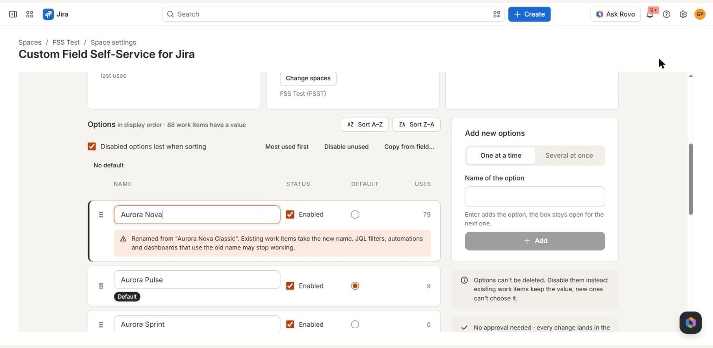
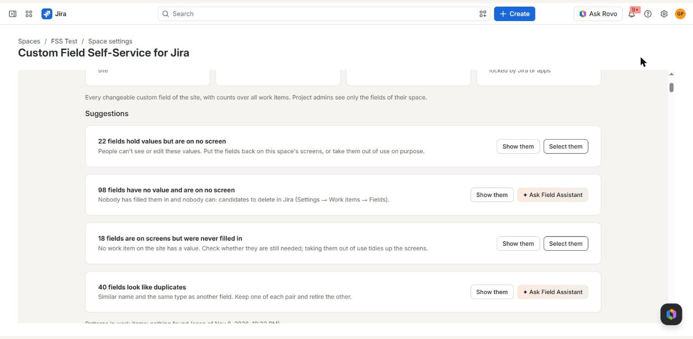
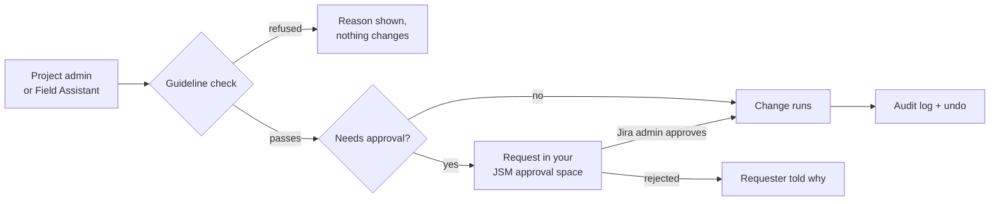

<p align="center">
  
</p>

<p align="center">
  <b>Project admins manage their own custom fields, safely and within your guidelines.</b><br>
  Jira admins approve what matters in one click. Every change is logged and can be undone.
</p>

<p align="center">
  
  
  
  
  
  
  
</p>

<p align="center">
  <a href="docs/marketplace/REVIEW-GUIDE.md"><b>Review guide</b></a> ·
  <a href="docs/marketplace/SECURITY-AND-PRIVACY.md"><b>Security &amp; privacy</b></a> ·
  <a href="https://www.superport.digital/en/apps/custom-field-self-service"><b>Documentation</b></a> ·
  <a href="CHANGELOG.md"><b>Changelog</b></a>
</p>

---

## Why

In most Jira sites, only Jira administrators can touch custom fields. Every new dropdown option becomes a ticket,
the admins become a bottleneck, and fields pile up that nobody uses. **Custom Field Self-Service** lets project
administrators do the everyday work themselves, inside guard rails their Jira administrator controls, and sends only
the changes that matter for approval.

## Highlights

| | |
| --- | --- |
| 🛡️ **Self-service with guard rails** | Naming rules, reserved names, limits, and a preview of the impact on work items before anything changes |
| ✅ **Approvals where they matter** | Requests land in your Jira Service Management space; Jira admins see a before/after picture and approve or reject in one click. Large changes need two people |
| ↩️ **Undo and audit log** | Who changed what, when and with whose approval. Undo from the log or straight from the notification |
| 🩺 **Field health** | Finds unused, hidden, stale and duplicate fields, with clean-up suggestions. Project admins see only their own space |
| ✨ **Field Assistant (Rovo)** | Prepares requests in a conversation and previews every change; nothing runs before the user confirms |
| 🔒 **Runs on Atlassian** | No calls outside Atlassian. Data stays in Forge storage under your data residency |

## Screenshots

<table>
  <tr>
    <td width="50%"><br><sub><b>Fields</b>: every field of the space, its context scope and options</sub></td>
    <td width="50%"><br><sub><b>Options editor</b>: usage per option, rename warnings and the impact before saving</sub></td>
  </tr>
  <tr>
    <td colspan="2"><br><sub><b>Field health</b>: clean-up suggestions built from what the fields are really used for</sub></td>
  </tr>
</table>

## How a change flows



Every entry point first passes the **emergency switch** and the **license check**, and the user's role is checked with
Jira on the server for every call. The browser never decides who may do what.

## Who sees what

| Role | Can |
| --- | --- |
| **Jira administrator** | Configure the app, see the health of every field on the site, change fields directly (logged, undoable), approve requests |
| **Project administrator** | Manage the fields their space uses, request changes, undo their own changes as a request; field health shows only their space |
| **Everyone else** | Request a field from any work item; the project admins decide first |

## For the Atlassian Marketplace review

Start with the **[review guide](docs/marketplace/REVIEW-GUIDE.md)**: it takes you from install to every main flow in
about 30 minutes and points to the code behind each concern.

| Document | What it covers |
| --- | --- |
| [REVIEW-GUIDE.md](docs/marketplace/REVIEW-GUIDE.md) | Install, set up and test as a reviewer; where to look in the code |
| [SECURITY-AND-PRIVACY.md](docs/marketplace/SECURITY-AND-PRIVACY.md) | Scopes and why each is needed, roles, stored data, personal data reporting, emergency switch, licensing |
| [SECURITY.md](SECURITY.md) | Reporting a vulnerability and our response times |
| [PRIVACY.md](PRIVACY.md) | App privacy notice |
| [EULA](https://www.superport.digital/en/apps/eula) · [Privacy policy](https://www.superport.digital/en/privacy) | SUPERPORT's legal terms |

| | |
| --- | --- |
| App ID | `ari:cloud:ecosystem::app/73eb7d75-cffc-403c-899b-1406d0b3826d` |
| Marketplace version | 3.1.0 (app version 1.1.0) |
| Payment | Paid via Atlassian, free for up to 10 users |
| Contact | dev@superport.digital |

## Repository layout

```
cfs-app/                  the Forge app
├── manifest.yml          modules, scopes, scheduled jobs
├── src/                  back end: resolvers, Rovo actions, triggers
│   ├── maintenance.js    emergency switch, passed first by every entry point
│   ├── license.js        Marketplace license check
│   ├── privacy.js        weekly personal data report, erasure of closed accounts
│   ├── frontend/         UI Kit work item action
│   └── shared/           pure logic, shared by the back end, the UI and the tests
├── static/main/          Custom UI (React) for the space and admin pages
├── agent/prompt.txt      Field Assistant instructions
└── test/                 unit tests (node --test) with fake Forge modules
docs/
├── marketplace/          review guide, security and privacy
└── images/               banner and screenshots for this page
```

## Build and test

Requires Node.js 22 or later (the app runs on Forge's `nodejs24.x` runtime) and the Forge CLI.

```bash
cd cfs-app
npm ci
npm test            # 128 unit tests
npm run lint        # eslint
npm run build:ui    # Custom UI
forge lint
```

## License

© 2026 SUPERPORT P.C., Marousi (Athens), Greece. All rights reserved. The source code is published for the Atlassian
Marketplace review and is not licensed for reuse; see [LICENSE](LICENSE). Customers use the app under the
[SUPERPORT EULA](https://www.superport.digital/en/apps/eula).

<p align="center"><sub>Made by <a href="https://www.superport.digital">SUPERPORT</a></sub></p>
